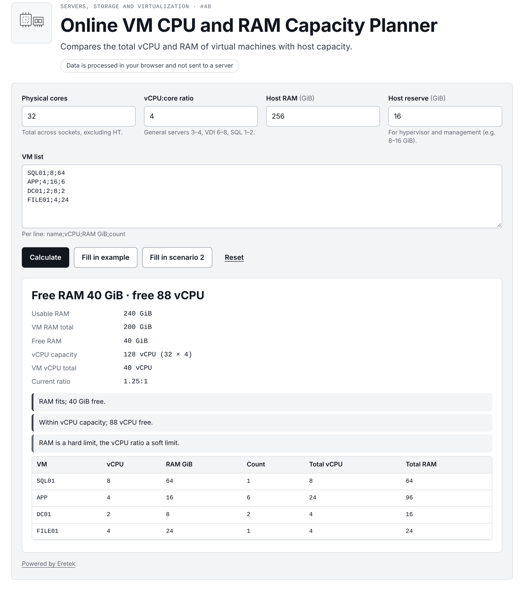

# VM CPU and RAM Capacity Planner

Check whether a list of virtual machines fits a host using cores, RAM and reserve; vCPU:core ratio and remaining RAM.

## Try it live

- [Türkçe](https://sistem.eretek.com/araclar/vm-cpu-ram-kapasite)
- [English](https://sistem.eretek.com/en/tools/vm-cpu-ram-capacity)
- [Deutsch](https://sistem.eretek.com/de/werkzeuge/vm-cpu-ram-kapazitaet)



## What it does

Compares the total vCPU and RAM of virtual machines with host capacity.

In virtualization CPU can be overcommitted, RAM practically cannot: when RAM overflows the host pages and every VM slows down. The tool treats RAM as a hard limit and vCPU as a soft limit at your chosen ratio, after subtracting the host and hypervisor reserve.

## Where it helps

If RAM is negative, spread VMs to another host or add RAM. If the ratio is exceeded, verify the real impact with CPU Ready (VMware) or CPU wait time (Hyper-V).

## How to use it

1. Enter physical host cores (excluding hyper-threading) and the target vCPU:core ratio.
2. Enter host RAM and the reserve for the hypervisor/parent partition.
3. Enter VMs one per line as `name;vCPU;RAM GiB;count` (count optional) and press Calculate.

### Fields

| Field | Description |
|---|---|
| Physical cores | Total across sockets, excluding HT. |
| vCPU:core ratio | General servers 3–4, VDI 6–8, SQL 1–2. |
| Host RAM |  |
| Host reserve | For hypervisor and management (e.g. 8–16 GiB). |
| VM list | Per line: name;vCPU;RAM GiB;count |

## Example input

Press **Fill in example** in the tool to load this input.

| Input | Value |
|---|---|
| Physical cores | `32` |
| vCPU:core ratio | `4` |
| Host RAM | `256` |
| Host reserve | `16` |

**VM list**

```text
SQL01;8;64
APP;4;16;6
DC01;2;8;2
FILE01;4;24
```

**Expected result:** 200 GiB of 240 GiB usable RAM is used, 40 GiB free; 40 vCPU is below the 128 vCPU capacity (ratio 1.25:1).

## Method and assumptions

Usable RAM = host RAM − reserve. vCPU capacity = cores × ratio. Row total = value × count. Dynamic memory, ballooning and page sharing are ignored.

## Limits and common mistakes

- NUMA boundaries, licensing and resources such as GPUs are not evaluated.

## Run it locally

The tool is plain HTML, CSS and JavaScript with no build step and no dependencies.

```bash
git clone https://github.com/eretek/vm-cpu-ram-capacity.git
cd vm-cpu-ram-capacity
node scripts/serve.js        # or: python3 -m http.server 8080
```

Open <http://127.0.0.1:8080/>. Add `?lang=tr` or `?lang=de` for Turkish or German; without it the page follows the browser language and falls back to English. You can also open `index.html` directly from disk.

Run the tests (Node.js 18 or later):

```bash
node test/run.js    # or: npm test
```

The tests run the tool's own fixtures and the worked examples in all three languages without a browser.

## How it works

All processing happens in your browser. The tool makes no network requests, uses no cookies or browser storage, and does not upload files you select.

No server-side component is needed. The version on the Eretek website renders the same page through a private WordPress plugin; that plugin only produces the page markup and is not part of this repository.

| Path | Purpose |
|---|---|
| `index.html` | Page shell |
| `src/app.js` | Builds the page in Turkish, English or German from `src/data.js` |
| `src/data.js` | Field definitions, examples and all texts in three languages |
| `src/core.js` | Shared runtime: validation, number formats, result rendering, CSV/ICS export |
| `src/tool.js` | The calculation or analysis for this tool |
| `docs/screenshot.png` | Screenshot used in this README |
| `src/tools.css`, `src/page.css` | Styles |
| `test/run.js`, `test/cases.json` | Headless tests |

## License and attribution

This tool is released under the [Eretek Website Attribution License](LICENSE). You may use, modify and redistribute it, including commercially. If you make it available on a website or web application, show a visible, clickable credit linking to https://eretek.com/ on every page where the tool is available, for example:

```html
<a href="https://eretek.com/">Powered by Eretek</a>
```

You may add `rel="nofollow"` to the link. Keep the copyright notice and license text in copies and redistributions.
